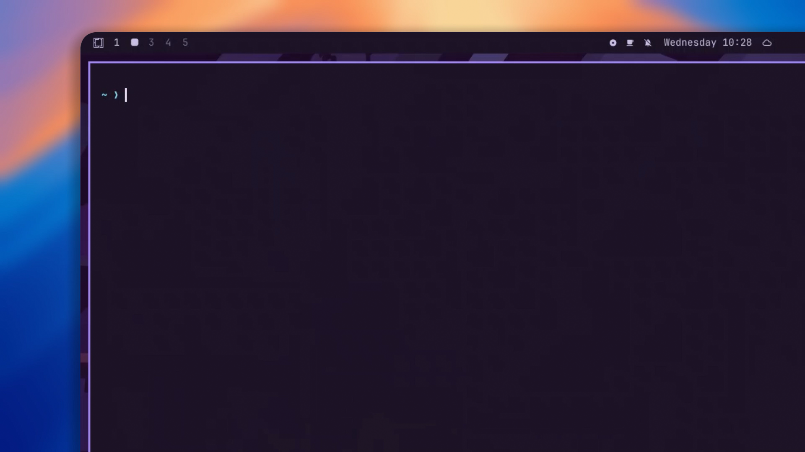

# glp

glp is a Go CLI that installs Linux desktop apps from a signed catalog.

[](https://raw.githubusercontent.com/pxradiso/glp/main/assets/glp.mp4)

Install desktop apps on Ubuntu, Debian, Fedora and friends with one command.
No daemon, no FUSE, no root by default, no runtime to install.

```console
$ glp install appimagetool
appimagetool 1.9.1
  Build an AppImage from an AppDir

  size    14.4 MiB
  source  appimagetool-x86_64.AppImage
  sha256  ed4ce84f0d9caff6…

Install? [Y/n]
  [1/4]  downloading appimagetool-x86_64.AppImage
  [████████████████████████] 100%  14.4 MiB / 14.4 MiB  5.6 MiB/s
  ✓ [2/4] extracting
  ✓ [3/4] linking appimagetool
  ✓ [4/4] menu entry and icon

run: appimagetool
```

## What it does

You type a name. glp looks it up in a signed catalog, shows the version, size and
checksum, then downloads the file straight from the vendor. Nothing is mirrored
or repackaged, so you get the same bytes upstream publishes.

Then it takes care of the boring part:

1. checks the SHA-256, and deletes a file that does not match instead of running it
2. unpacks the archive into `~/.local/opt/glp/<app>/<version>`, no FUSE, no mount
3. puts the launcher in `~/.local/bin`, with a menu entry and an icon next to it
4. if the app needs system packages to start, it names them in the prompt and
   installs them with the same yes

Upgrades work the same way: the new version is unpacked next to the old one, a
symlink is swapped, and the old tree stays on disk until you remove the app.

## Where it runs

glp itself is one static binary for `linux/amd64` and `linux/arm64`, so it starts
on any modern Linux. The package-manager integration, used by `glp doctor` and by
apps with system dependencies, covers four families:

- **Debian/Ubuntu** (apt): Ubuntu, Debian, Linux Mint, Pop!_OS, elementary OS, Zorin OS, Kali, Raspberry Pi OS, KDE neon
- **Fedora/RHEL** (dnf): Fedora, RHEL, CentOS Stream, Rocky Linux, AlmaLinux, Oracle Linux, Amazon Linux
- **openSUSE** (zypper): openSUSE Leap, openSUSE Tumbleweed, SLES
- **Arch** (pacman): Arch, Manjaro, EndeavourOS, CachyOS, Garuda

On another distribution glp installs apps that need no system packages, but it
cannot map missing libraries to a package. The current catalog is x86_64 only, so
an arm64 build of glp runs but has nothing to install yet.

NixOS is detected, but it has no package manager glp can drive. The static
binary runs, and unpacking does not need FUSE. To start the extracted apps,
enable `programs.nix-ld.enable = true` and put `~/.local/bin` on PATH, for
example with `environment.localBinInPath = true`. If an AppImage does not unpack,
install `squashfs-tools` with
`nix profile install nixpkgs#squashfs-tools`. `glp doctor` still lists missing
libraries, but Nix owns the store, so glp cannot install them for you; add them
to `programs.nix-ld.libraries` when needed.


## Install

```console
$ curl -fsSL https://raw.githubusercontent.com/pxradiso/glp/main/install.sh | sh
```

The script works out whether you are on `linux/amd64` or `linux/arm64`, checks
the release manifest's ed25519 signature with the key embedded in it, verifies
the binary's SHA-256, and puts it in `~/.local/bin`. No root needed. Set
`PREFIX=/usr/local` for a system-wide copy, which will ask for root.

From a checkout, the same script builds what you are looking at:

```console
$ ./install.sh              # build this checkout
$ ./install.sh --release    # install the latest signed release instead
```

Source builds need Go 1.27 or newer. The result is one static binary.

## Commands

| Command | |
|---|---|
| `glp search <term>` | fuzzy search over names, labels and commands |
| `glp info <app>` | version, size, checksum, dependencies |
| `glp install <app>[@ver]` | download, verify, extract, integrate |
| `glp list` | installed apps |
| `glp upgrade [app]` | upgrade one app or everything |
| `glp remove <app>` | delete binaries, menu entry, icon, files |
| `glp doctor [app]` | find missing libraries and install them |
| `glp update [--check]` | check glp and installed apps for updates |
| `glp index refresh` | re-fetch and re-verify the catalog |
| `glp index show` | print the source and cache paths |
| `glp index set <url>` | switch to another catalog source |
| `glp version` | print the version |

A few short aliases exist because typing is not free: `glp s` for search,
`glp i` or `glp add` for install, `glp ls`, `glp rm` or `glp uninstall`,
`glp up` for upgrade, `glp fix` for doctor.

Names are forgiving. An exact name always wins and never prompts. Otherwise a
unique near miss asks first, and several near misses become a numbered list:

```console
$ glp install win
did you mean winboat? [Y/n]

$ glp install vscod

2 apps match "vscod"

  1  vscode    Code editor with debugging and Git…
  2  vscodium  VS Code without the telemetry

pick one [1-2, enter to cancel]:
```

Matching looks at the catalog name, the menu label and the launcher command, so
`code` finds vscode and `chrome` finds chromium. With `GLP_YES=1` a single
candidate is accepted and an ambiguous one is refused, so unattended runs never
guess.

Environment:

- `GLP_INDEX_URL` for the catalog location. `https://`, `file://` and plain paths all work.
- `GLP_TRUST_KEY` to override the embedded public key (development only).
- `GLP_YES=1` skips the install confirmation.
- `GLP_YES_ROOT=1` approves root package installs separately, which is what an
  unattended `GLP_YES=1` run needs before it will touch `sudo`.
- `GLP_UPDATE_URL` for the release manifest, if you host your own.
- `GLP_YES_UPDATE=1` skips the update prompt, never the catalog prompt.
- `GLP_NO_UPDATE_CHECK=1` turns off the automatic daily check.
- `GLP_PLAIN=1` disables colour and animation, which also happens by itself
  when stderr is not a terminal.
- `NO_COLOR=1` does the same for scripts that already use that convention.


## What is in the catalog

65 apps at the moment. This table is a snapshot; the signed catalog is the real
list, and `glp search` reads it live.

| App | What it is |
|---|---|
| `anki` | Spaced repetition flashcards |
| `appimagetool` | Build an AppImage from an AppDir |
| `appimageupdate` | Update AppImages in place using zsync deltas |
| `arduino-ide` | Arduino IDE 2 for boards and microcontrollers |
| `artcraft` | Launcher for the ArtCraft creative suite |
| `audacity` | Multi-track audio editor and recorder |
| `ayugram` | Telegram client with ghost mode and customization |
| `bitwarden` | Password manager with sync |
| `blender` | 3D modelling, animation and rendering |
| `brave-browser` | Chromium browser with ad blocking built in |
| `bruno` | Offline API client |
| `cadcraft` | 2D drafting and computer-aided design |
| `chromium` | Open-source web browser, upstream snapshot build |
| `darktable` | RAW photo workflow and darkroom |
| `dbeaver` | Database client for SQL and NoSQL |
| `deckcraft` | Presentations and slide shows |
| `designcraft` | Page layout and desktop publishing |
| `discord` | Voice, video and text chat for communities |
| `drawio` | Diagram and flowchart editor |
| `effectcraft` | Motion graphics and visual effects |
| `epic-games-launcher` | Epic Games store and launcher |
| `etcher` | Flash OS images to USB drives |
| `figcraft` | Interface design and prototyping |
| `filmcraft` | Non-linear video editor |
| `firefox` | Mozilla browser, the open web reference |
| `flameshot` | Screenshot tool with annotation |
| `floorp` | Firefox fork with a vertical tab sidebar |
| `fnf-game` | Rhythm game with a story mode |
| `freecad` | Parametric 3D CAD modeller |
| `ghostty` | Fast terminal emulator |
| `gimp` | Photo and image editor |
| `gridcraft` | Spreadsheets and data analysis |
| `helium-browser` | Privacy-focused Chromium browser |
| `heroic` | Epic and GOG games on Linux |
| `joplin` | Notes and to-do lists, synced and searchable |
| `kdenlive` | Video editor for cutting and finishing |
| `keepassxc` | Offline password manager |
| `krita` | Painting and illustration studio |
| `lazygit` | Terminal UI for git |
| `librewolf` | Firefox fork tuned for privacy |
| `lightcraft` | Photo library and raw developer |
| `mocktail` | Play Roblox on Linux |
| `musescore` | Scorewriter for composing and printing sheet music |
| `neovim` | Modal text editor for the terminal |
| `obsidian` | Markdown knowledge base and note taking |
| `onlyoffice` | Office suite with strong docx compatibility |
| `pdfcraft` | Read, organize and secure PDF files |
| `photocraft` | Image editor with layers and curves |
| `prismlauncher` | Minecraft launcher with modpack support |
| `qbittorrent` | BitTorrent client with a web interface |
| `rpi-imager` | Write OS images to SD cards |
| `shotcut` | Video editor with wide format support |
| `soundcraft` | Audio recording, editing and mixing |
| `spotify` | Music streaming client |
| `steam` | Game store and launcher |
| `telegram` | Cloud messenger with desktop client |
| `thunderbird` | Mozilla mail and calendar client |
| `ungoogled-chromium` | Chromium without Google integration |
| `vectorcraft` | Vector illustration and design |
| `vesktop` | Discord client with Vencord plugins |
| `vinegarhq` | Run Roblox Studio on Linux |
| `vscode` | Code editor with debugging and Git built in |
| `vscodium` | VS Code without the telemetry |
| `winboat` | Run Windows apps on Linux |
| `wordcraft` | Word processing and documents |
| `zed` | Fast collaborative code editor |
| `zen-browser` | Firefox-based browser with a focus on calm browsing |

Run `glp info <app>` for the version, size and checksum of any of them.

## What it is not

**Not a sandbox.** An extracted app runs with your user's permissions, so treat
it like anything else you downloaded. If you want isolation, use Flatpak or
`bwrap` yourself.

**Not a store.** The catalog holds metadata, not files. Downloads come from
upstream, which also means a vendor moving a release breaks the entry until the
catalog is updated.

**Not a distro.** Everything lands under `~/.local` and your system package
database is left alone, except for the packages you approve.

## Apps that only ship source code

Some vendors publish nothing but a source tarball. Those entries carry a `build`
block instead of a ready binary, like Vinegar:

```json
"format": "tar.xz",
"deps": { "fedora": ["gtk4-devel", "libadwaita-devel", "..."] },
"build": { "commands": [["make", "install", "PREFIX=/usr", "DESTDIR={dest}"]] }
```

glp verifies the tarball, names the build packages in the prompt, installs them
with the same root approval, then runs each step as an argv slice, never through
a shell. `{src}`, `{dest}` and
`{final}` are substituted; `{final}` is where the build will live after the
atomic rename. All of it comes from the signed catalog, so a build step cannot
appear without a new catalog signature.

The result is the same as a binary install: `~/.local/opt/glp/<app>`, a launcher
in `~/.local/bin`, a menu entry. Vinegar compiles to about 30 MB instead of the
1 GB Flatpak runtime it would otherwise pull in.

## When an app installs but does not start

Almost always it is one missing system library. glp runs `ldd` on the launcher,
ignores anything the AppImage already bundles, and asks the package manager which
package provides the rest:

```console
$ glp doctor discord

discord 1.0.167
  missing (1):
    libXss.so.1

discord needs (root, fedora):
  sudo dnf install -y libXScrnSaver
Install them? [Y/n]
```

After an install the same check runs automatically, and re-checks afterwards. The mapping is
done by your package manager (`dnf provides`, `apt-file`, `pacman -F`,
`zypper search --provides`), so there is no table of library names baked into the
binary. On Arch the first lookup usually needs `sudo pacman -Fy` once, to have a
file database to search.

## System packages the app needs

Some apps cannot start without a distribution package, like `vlc` for Friday
Night Funkin. The catalog lists them, the install summary names them, and the
same yes installs them:

```console
$ glp install fnf-game
  packages  vlc (root)

Install? [Y/n]

  installing vlc (root)
```

If root is not approved the app is still installed, and glp prints the command it
would have run instead of asking a second time:

```console
vlc still missing (root not approved)
  run: sudo pacman -S --noconfirm vlc
```

## Security model

The catalog is the trust root, so glp treats it as hostile input:

- The catalog is signed with **ed25519** and the public key is compiled into the
  binary. The signature is checked on every load, including cached copies, and an
  unsigned or tampered catalog is refused before anything is downloaded.
- Every download is pinned by **SHA-256** in the signed catalog and verified
  after download. A mismatched file is deleted, never executed. For an itch.io
  entry the link is resolved at install time, but the bytes are still pinned.
- Package names are validated against `^[A-Za-z0-9][A-Za-z0-9+._-]*$` and passed
  to the package manager through `execve`, never a shell. A catalog can name
  packages, but it cannot smuggle commands.
- Root actions only happen after a yes from you. The install confirmation names
  the packages it will install, so that one yes covers them. `GLP_YES` alone does
  not, and automating `glp install` never implies automating `sudo`.

What this does not protect you from: a stolen signing key, or a vendor replacing a
release file at a URL you already trust. SHA-256 pins the file, not the vendor's
intent. Keep the private key offline.

## Catalog format

One JSON document plus a detached signature (`index.json.sig`, base64):

```json
{
  "schema": 1,
  "updated": "2026-10-28T11:36:00Z",
  "apps": [
    {
      "name": "discord",
      "version": "1.0.167",
      "summary": "Voice, video and text chat for communities",
      "homepage": "https://discord.com",
      "license": "proprietary",
      "archs": ["x86_64"],
      "url": "https://stable.dl2.discordapp.net/apps/linux/1.0.167/discord-1.0.167.tar.gz",
      "sha256": "…64 hex chars…",
      "size": 2395987,
      "format": "tar.gz",
      "bins": ["discord"],
      "desktop": { "name": "Discord", "icon": "discord", "categories": ["Network"] },
      "deps": {}
    }
  ]
}
```

`format` is `appimage` when omitted. Tarballs (`tar.gz`, `tar.xz`, `tar.bz2`,
`tar.zst`) are supported too, because some vendors ship nothing else, Discord
among them. A single wrapping directory is flattened automatically, and `tar.gz`
is unpacked in-process with a path-traversal guard.

Zip archives are supported for vendors that wrap an AppDir or a single AppImage,
and `.deb` for vendors that only publish a Debian package, like Spotify. A deb is
just an `ar` container around `data.tar.*`.

Some games only ship through itch.io, and the download link itch hands out is
signed and expires after about a minute. Those entries name the game page and the
upload id instead of a URL:

```json
"format": "zip",
"itch": { "page": "https://example.itch.io/game", "upload": 123456 },
```

glp replays the same free download flow a browser does, then verifies the bytes
against the pinned SHA-256 like any other entry. The link is dynamic, the content
is not: a different file is still refused.

`icon` points at art inside the archive, for builds that ship a logo but no
desktop file to name it. Games keep their sprites in a sheet, so `crop` cuts one
frame, as `[x, y, width, height]`:

```json
"icon": { "path": "assets/images/icons/icon-bf.png", "crop": [0, 0, 150, 150] },
```

`workdir: true` starts the program from its own directory. Game engines such as
Lime look for the native library in the current directory, not next to the
binary, so the menu entry gets a `Path=` line and the terminal launcher a one
line `cd`. Without it a game can start from the menu and fail from a shell, or
the other way around.

`bins` are paths relative to the AppDir root; a bare name is also accepted and
looked up under `usr/bin`. `deps` is keyed by distro family (`debian`, `fedora`,
`suse`, `arch`) and is usually empty, since a well-built AppImage needs nothing.

## Adding an app does not need a new release

The catalog lives outside the binary. `glp search`, `info`, `install` and
`upgrade` check the signed catalog source every time, so publishing a new
`index.json` and `index.json.sig` is enough: users see the new app on their next
command and nothing in the installed program changes. If the source is
unreachable, the last signed copy in the cache is used.

glp never swaps its own binary without an explicit yes, and installed apps never
update on their own. Only the catalog refreshes by itself.

## Updating glp

The binary is static, CGO-free Go, so one `linux/amd64` build runs on every
distribution where the kernel and CPU are new enough, whatever the libc or the
package manager. There is nothing distro-specific to update, and a platform
without a matching asset is never offered one.

`glp update` fetches `update.json` from the releases page, verifies its ed25519
signature with the same key that signs the catalog, and compares versions:

```console
$ glp update
glp 0.2.0 is available (you have 0.1.0)
faster catalog refresh, deb support
Update now? [Y/n]
glp updated to 0.2.0
```

The new binary's SHA-256 is pinned in the signed manifest, checked after
download, and only then renamed over the running executable. The old inode stays
alive until the process exits, so updating while glp runs is safe. If glp lives
in a directory you cannot write to, the update fails and names that path instead
of trying to escalate.

If nothing is published at the update URL, which is normal for a build made from
source, glp says so and exits clean instead of reporting a 404. A source that
cannot be reached at all gets one short line, with no host or status code to
read:

```console
$ glp update
no update channel for this build

$ glp update
glp: update servers are not responding
```

The same command refreshes the catalog and lists the installed apps whose catalog
entry moved ahead, which is what `glp upgrade` would install:

```console
$ glp update
2 apps can be updated

  app      installed  available      size
  discord  0.0.84     0.0.90      98.1 MiB
  vscode   1.95.0     1.96.0     124.8 MiB

upgrade: glp upgrade

glp 0.1.0 is up to date
```

`glp update` never installs an app by itself; `glp upgrade` does that, keeping its
per-app confirmation. `glp update --check` reports glp and app updates and stops
without asking anything.

Daily, on an interactive terminal only, the first glp command of the day asks
once about a new release. Declining or being offline costs nothing and is not
retried until the next day. `GLP_NO_UPDATE_CHECK=1` disables that check entirely.

The manifest is small and separate from the binaries:

```json
{
  "schema": 1,
  "version": "0.2.0",
  "notes": "faster catalog refresh, deb support",
  "assets": {
    "linux/amd64": {
      "url": "https://github.com/pxradiso/glp/releases/download/v0.2.0/glp-linux-amd64",
      "sha256": "…64 hex chars…",
      "size": 5432109
    }
  }
}
```

Assets are keyed by `GOOS/GOARCH`. A missing entry for the current platform means
no update is offered, which handles unsupported systems without a special case in
the code.

### Making a release

```console
$ VERSION=0.2.0 NOTES="faster catalog refresh" ./scripts/release.sh
```

This builds `linux/amd64` and `linux/arm64`, writes `dist/update.json` with the URL
and checksum of each, and signs it. `NOTES` is optional and shown by `glp update`.
Upload the two binaries, `update.json` and `update.json.sig` to the `v0.2.0`
GitHub release, and the default `releases/latest/download/update.json` URL serves
the new version.

## Signing

```console
# once, offline
$ go run ./tools/sign keygen ~/.config/glp/dev.key
# copy the printed public key into embeddedPubKey in trust.go, then rebuild

# every time the catalog changes
$ go run ./tools/sign sign ~/.config/glp/dev.key catalog/index.json

# release manifests are signed the same way
$ go run ./tools/sign sign ~/.config/glp/dev.key dist/update.json
```

Never commit the private key. Rotating it means shipping a new glp.

## Limitations worth knowing

- **glibc.** A binary built on a recent distro will not run on an older one. Build
  AppImages inside an old container (Debian oldstable). That is the whole trick
  behind "runs anywhere".
- **Dead links.** Binaries come from upstream, so a moved release breaks the entry
  until the catalog is refreshed. glp fails loudly rather than silently.
- **itch.io entries.** The link itch hands out expires in about a minute, so glp
  replays the page flow at install time. If itch changes that flow the install
  stops with an error; the pinned SHA-256 still guarantees the bytes.
- **Debian needs `apt-file`** for `glp doctor` to map a soname to a package.
  Without it the missing libraries are still listed, just not installed.
- **No portals.** File choosers and notifications come from the host desktop. That
  is fine for normal apps and is exactly the complexity glp avoids.
- **Bootstrapper apps.** Discord's official tarball is a ~2 MB launcher that
  downloads the real application (hundreds of MB) into `~/.config/discord` on
  first start. `glp remove` cleans up what glp installed, not that payload.
- **Download cache.** `~/.cache/glp/downloads` keeps the archive of an installed
  app so a repair does not download it again. `glp index refresh` clears archives
  that do not match an installed version, including old versions after an
  upgrade. An interrupted transfer keeps a `.part` file and resumes from there
  with an HTTP range request; a file that fails its checksum is deleted instead
  of being resumed.
- **Desktop cache.** If a menu entry does not show up, run
  `update-desktop-database ~/.local/share/applications`.
